<p align="center">
  <a href="https://furkiozknn.github.io/marti/"></a>
</p>

<p align="center">
  <a href="https://furkiozknn.github.io/marti/"></a>
  
  
  <a href="LICENSE"></a>
  
</p>

<p align="center"><b>An endless 3D arcade flyer over the Istanbul strait: as a seagull, snatch simit from ferry decks, dive for jumping fish, dodge bridges, masts and kites, and fly on from a golden afternoon through sunset into a night of fireworks.</b></p>

<p align="center">
  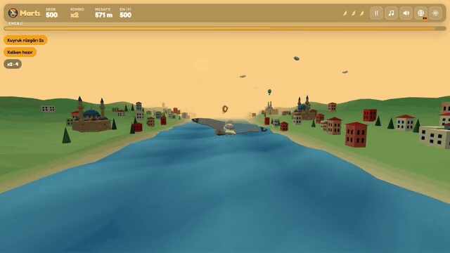
</p>

<p align="center"><b>Play online: <a href="https://furkiozknn.github.io/marti/">https://furkiozknn.github.io/marti/</a></b> (desktop and phone, no install)</p>

## Highlights

- **An endless run that speeds up.** Steer inside the corridor over the water; the first 30 seconds are forgiving, then
  the run gets faster and busier.
- **Stamina and three feathers.** Stamina drains faster and faster and only simit and fish refill it; every crash costs
  one of three feathers.
- **Obstacles with their own rules.** Bridge decks and cables, ships' hulls, cabins, masts and sails, kites on long
  strings, storm clouds that push you and a rival gull flock that steals your simit.
- **Power-ups and combos.** Tailwind (speed and score x1.5), golden simit (score x2) and a shield feather that blocks
  one hit; a combo multiplier climbs up to x5.
- **Day to night over Istanbul.** Mosques with domes and minarets, the Galata tower, the Maiden's tower on its islet,
  yalı mansions and city ferries, from afternoon gold through sunset to a starry night with lit windows and fireworks.
- **Daily missions and high scores.** Three missions a day and a local top-5 table, saved in your browser.
- **A chick to feed (v2).** Carry up to two simit to a rooftop nest on the shore and fly low past it: the chick chirps,
  you get +150 and a feather back. Feeds add up over all runs; at 5, 15 and 30 feeds the chick grows, and from the
  last stage a young gull flies beside you and takes one hit per run.
- **Pier snacks and near misses (v2).** Rows of simit and a fish crate beside the jetty posts at the edge of the
  corridor (a low hit on a post costs a feather). Passing a hull, a mast, a kite or a cable closely scores +25.
- **A late-run ramp (v2).** After three minutes storm clouds come more often, kites fly in pairs, hostile flocks are 20%
  faster, and a gust is announced two seconds before it pushes the gull.
- **Did you know (v2).** Facts about the gulls of Istanbul and about simit, on the title and the game-over card.
- **Generated music and sound.** A beat with layers that build as you speed up, wing flaps, gull calls and ferry horns,
  all made with Web Audio; pausing or hiding the tab silences everything.

## How to play

> [!TIP]
> **Goal:** fly as far and score as high as you can. The run is over when your stamina runs out or you lose all three
> feathers.

Steer the gull with the mouse, a finger or the arrow keys, and keep it in the corridor over the water. Fly through simit
on ferry decks and in the air to refill stamina and build a combo; dive (hold `Space`, hold the mouse button or tap) to
catch jumping fish.

<details>
<summary><b>More rules</b></summary>

- Stamina starts full and drains a little faster every second, and faster still while you dive.
- Every pickup in a row raises the combo; every fourth one adds 1 to the score multiplier, up to x5. A pause in pickups
  resets it.
- The rival flock steals your simit: it costs stamina and resets the combo.
- Hitting a bridge deck, a cable, a hull, a mast or a kite costs a feather, unless a shield feather absorbs the hit.
- Every day brings three missions (for example a 10 combo in one run or a distance to fly); the top 5 runs are kept.

</details>

### Controls

| Action | Mouse / touch | Keyboard |
|---|---|---|
| Steer | move the mouse / drag (relative to where the finger went down) | arrows / `WASD` |
| Dive (for fish) | hold the mouse button / tap | hold `Space` |
| Start / play again | Start button | `Space` / `Enter` |
| Pause menu (Resume, Restart, Settings, Main menu) | pause button | `P` / `Esc` |
| Mute all sound (restores the level) | speaker button in the top bar | `N` |
| Music / effects / language | top bar | `M` / `X` / `L` |
| Fullscreen | settings | `F` |

Settings (master, music and effects volume, TR / EN, Low / High quality, fullscreen) are saved in `localStorage` under
`arena.marti.settings`; the top 5 scores under `arena.marti.best` and the daily missions under `arena.marti.save`. The
first visit follows the browser language.

<details>
<summary><b>URL flags for testing</b></summary>

| Flag | Effect |
|---|---|
| `?auto` | the game plays itself (self-test bot) |
| `?debug` | fps, draw calls, state, loaded assets and JS errors on screen; `window.martiSim(seconds)` fast-forwards the game |
| `?sim=N` | fast-forward N seconds once the assets are ready |
| `?low` | no shadows, pixel ratio 1, half the particles |
| `?noassets` | skip the generated models (procedural look) |
| `?lang=en` / `?lang=tr` | language |
| `?run` | start a run straight away |
| `?t0=N` | start each run N seconds into the day (`?t0=150` is night) |
| `?chick=N` | show chick stage N (1 to 4) regardless of the saved feeds; `?chick=4` brings the young gull |

</details>

## Screenshots

<table>
  <tr>
    <td width="33%">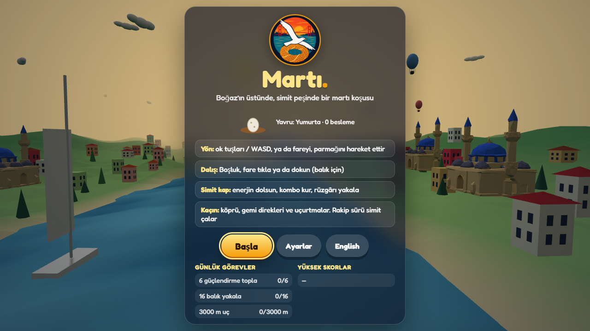<br><sub>Title screen and daily missions</sub></td>
    <td width="33%">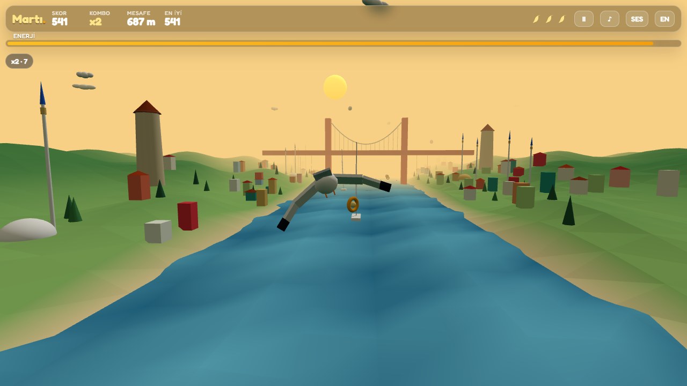<br><sub>Afternoon over the strait</sub></td>
    <td width="33%">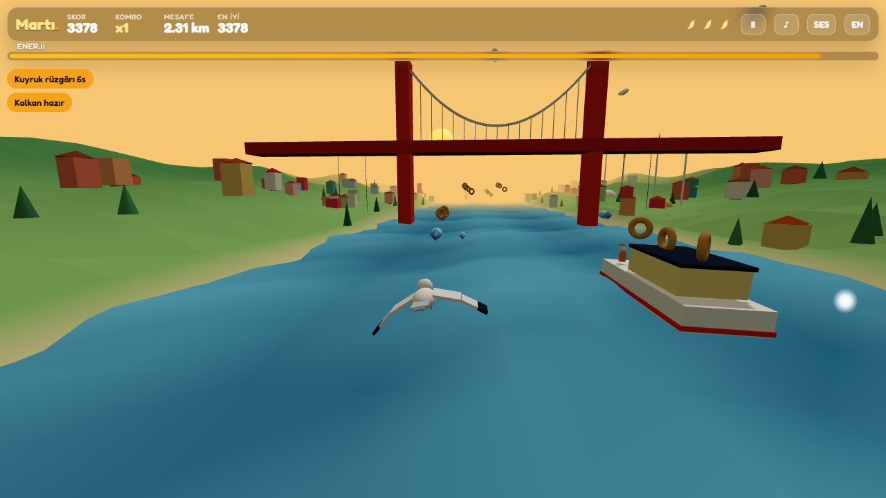<br><sub>Under the bridge</sub></td>
  </tr>
  <tr>
    <td>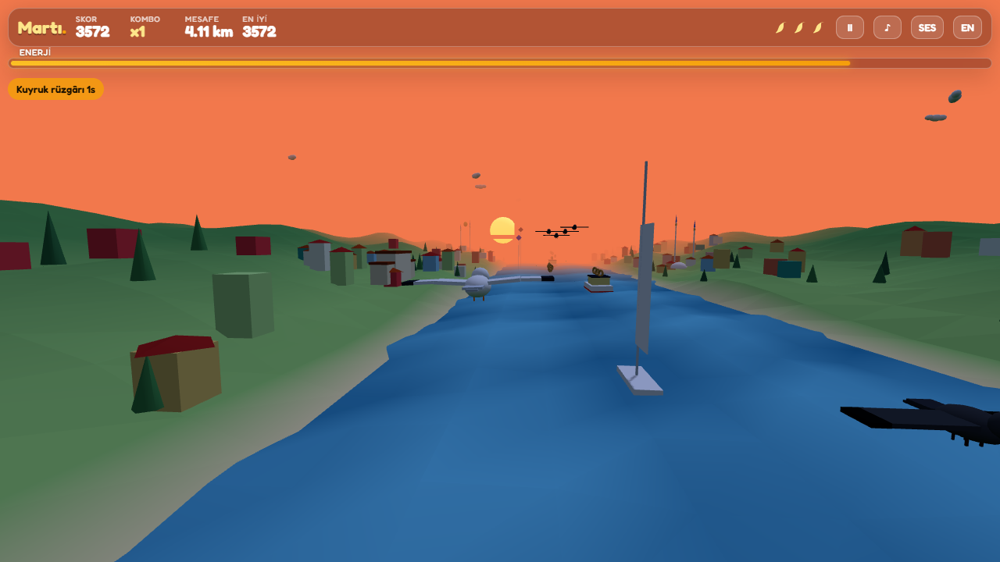<br><sub>Sunset and the Galata tower</sub></td>
    <td>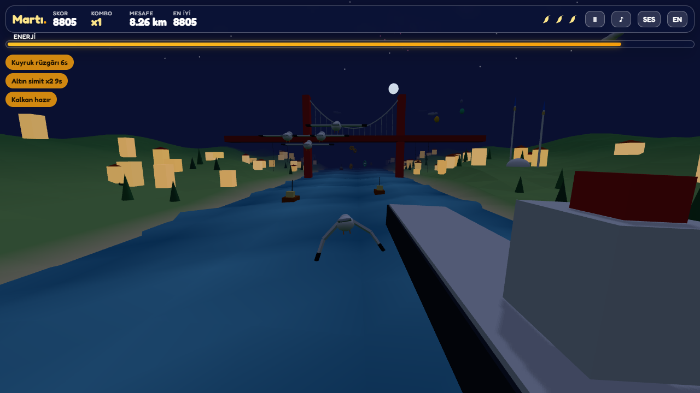<br><sub>Night, golden simit active</sub></td>
    <td>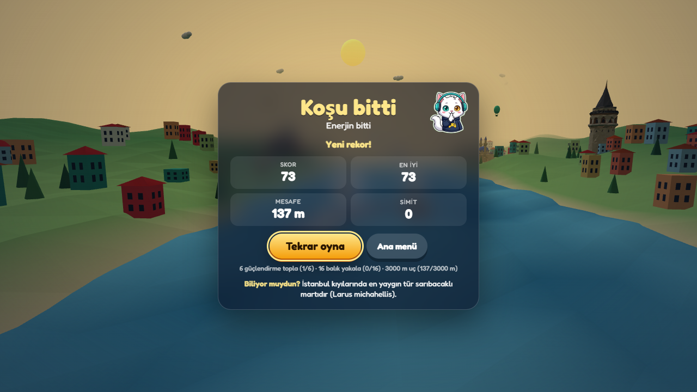<br><sub>Run over, new record</sub></td>
  </tr>
</table>

<details>
<summary><b>The gull up close, settings and the phone layout</b></summary>

<table>
  <tr>
    <td width="50%">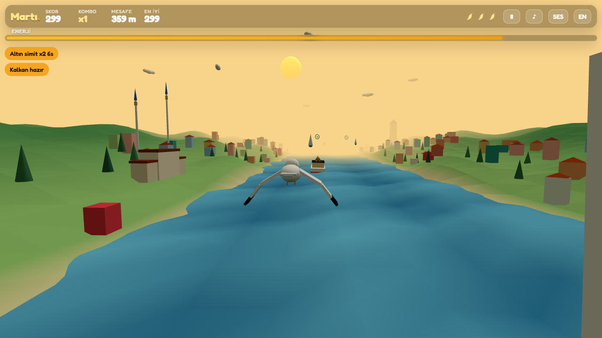<br><sub>The gull up close</sub></td>
    <td width="50%">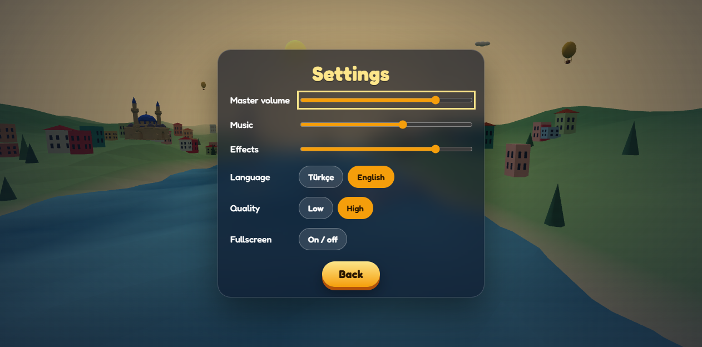<br><sub>Settings</sub></td>
  </tr>
</table>

<p align="center">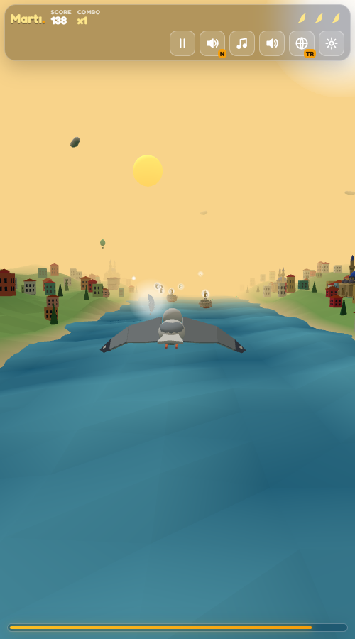<br><sub>On a phone</sub></p>

</details>

## v2 update

Upgraded by **Claude Haiku 5.5** with Claude Code from [prompts/marti-v2.md](prompts/marti-v2.md). The v2 pass adds the
first-run prompts (steer, dive, stamina; each shown once and then remembered), the mute key, the rooftop nests and the
chick that grows across runs, pier snacks with jetty posts, near-miss bonuses, the late-run ramp with gust warnings, a
soft halo behind simit, fish and power-ups, and the "Did you know" facts (sourced in comments in `index.html`). The
saved data keeps its keys (`arena.marti.settings`, `arena.marti.best`, `arena.marti.save`); the save record gains the
fields `chick`, `hints` and `factIdx`. Mascot: a small Turkish Van kitten on the game-over card, see
[CREDITS.md](CREDITS.md).

## Running locally

Serve the folder over HTTP (opened from `file://`, the browser blocks the model files and the game uses its procedural
models):

```
python -m http.server 8000
```

then open <http://localhost:8000/>.

## How it was made

Built by **Claude Haiku 5.5** with Claude Code from one prompt: [prompts/marti.md](prompts/marti.md). The first version
was fully procedural: the strait, the shores, the boats, the landmarks and the gull are low-poly primitives with vertex
colours, and the music and sounds are synthesised with the Web Audio API. Before release, an independent bot run in a
real browser flew 796 seconds before running out of stamina, with 0 JS errors.

The assets were remastered by the orchestrator, **Claude Opus 5.5**, with generated models: Tripo text-to-3D (through
Higgsfield) for the simit (also the golden simit), the fish, the shield feather, the ferry, the fishing boat, the
sailboat, the mosque, the Galata tower, the Maiden's tower and the yalı, and GPT Image for the crest and the favicon.
They were fitted with glTF-Transform (about 0.88 MB in `assets/`), and every procedural model stays as the fallback. A
generated gull was tried and rejected, so the gull is a redesigned procedural one with grey wing tops, white undersides
and black tips. Prompts, sizes and the rejected models: [docs/assets.md](docs/assets.md). A Godot 4 remake was made in
round 2.

Martı is part of the **Claude Game Arena** series, where each game is built by a Claude model from one prompt. The other
games: [Hisar](https://furkiozknn.github.io/kale-savunmasi/) · [Çay Ocağı](https://furkiozknn.github.io/cay-ocagi/) ·
[Çini Ustası](https://furkiozknn.github.io/cini-ustasi/) · [Kervan](https://furkiozknn.github.io/kervan/) ·
[Dolmuş](https://furkiozknn.github.io/dolmus/) · [Peri Golf](https://furkiozknn.github.io/peri-golf/) ·
[Mehter](https://furkiozknn.github.io/mehter/) · [Boğaz Vapuru](https://furkiozknn.github.io/bogaz-vapuru/) ·
[Simit Fırını](https://furkiozknn.github.io/simit-firini/) · [Karagöz](https://furkiozknn.github.io/karagoz/) ·
[Lale Bahçesi](https://furkiozknn.github.io/lale-bahcesi/)

**Round 5:** [Kapadokya Balonu](https://furkiozknn.github.io/kapadokya-balonu/) ·
[Ebru](https://furkiozknn.github.io/ebru/) · [Kırkpınar](https://furkiozknn.github.io/kirkpinar/) ·
[Çarşı Kaçışı](https://furkiozknn.github.io/carsi-kacisi/)

**Round 6:** [Topkapı Gecesi](https://furkiozknn.github.io/topkapi-gecesi/) ·
[Hamsi](https://furkiozknn.github.io/hamsi/) · [Pamukkale](https://furkiozknn.github.io/pamukkale/) ·
[Mimar Sinan](https://furkiozknn.github.io/mimar-sinan/)

## Türkçe

**Martı**, İstanbul Boğazı üzerinde geçen sonsuz bir 3D arcade uçuş oyunu. Bir martı olarak vapurların güvertesinden
simit kap, sıçrayan balıklar için dal; köprülerden, direklerden ve uçurtmalardan kaç. Altın bir öğleden sonradan gün
batımına, oradan havai fişekli bir geceye uç; her gün üç yeni görev var. Kurulum yok; masaüstünde ve telefonda tarayıcıda
oynanır. Claude Haiku 5.5 tarafından Claude Code ile tek bir prompt'tan yapıldı.

**Oyna:** https://furkiozknn.github.io/marti/

## License

MIT, see [LICENSE](LICENSE).

Like the game? You can support new rounds on [Buy Me a Coffee](https://buymeacoffee.com/furkiozkann). The game stays free.
