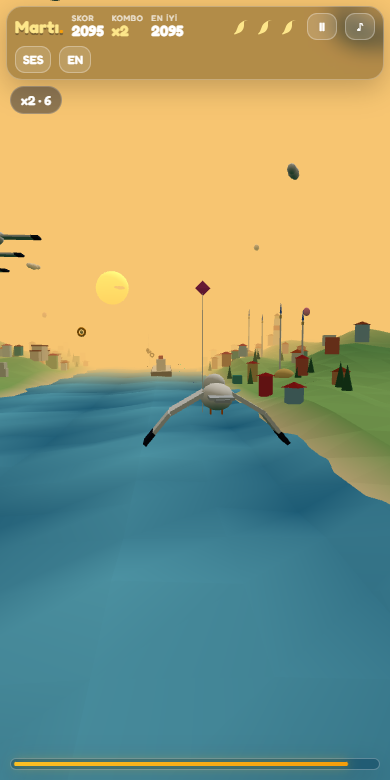

# 🕊️ Martı · Seagull Run

**[▶ Play in your browser](https://furkiozknn.github.io/marti/)** · Türkçe & English · desktop & mobile · free, no install

An endless 3D arcade flyer in a **single `index.html`** (Three.js, no build step, no asset files).
You are a seagull over the Istanbul strait: snatch simit from ferry decks, dive for jumping fish, dodge
bridge cables, masts and kites, and fly on from a golden afternoon through sunset into a night of fireworks.

## Features

- **Endless run that speeds up:** steer inside the corridor over the water; the first 30 seconds are forgiving.
- **Stamina and lives:** simit and fish refill stamina, which drains faster over time. Three feathers (hits) per run.
- **Obstacles:** bridge cables and towers, ships' masts and funnels, kites on long strings, storm clouds that push you,
  and a rival gull flock that steals your food.
- **Power-ups:** tailwind (speed + score ×1.5), golden simit (score ×2), shield feather. Combo multiplier up to ×5.
- **Daily missions** and a local top-5 high score table, saved in your browser.
- **Day to night:** the sky moves from afternoon gold through sunset to a starry night with lit windows and fireworks.
- **Generated music and sound:** a beat with layers that build as you speed up, wing flaps, gull calls, ferry horns,
  all made with Web Audio. Music and sound toggle separately.

| | |
|---|---|
|  |  |
|  |  |
|  |  |

## Controls

| Action | Keyboard | Mouse | Touch |
|---|---|---|---|
| Steer | Arrows or `WASD` | Move the mouse | Drag anywhere |
| Dive (for fish) | `Space` | Hold click | Tap |
| Pause | `P` or `Esc` | Pause button | Pause button |
| Music / sound / language | `M` / `X` / `L` | Top bar | Top bar |

## Run it locally

Download the repo and double-click `index.html` (it needs internet the first time, to load Three.js and the font from a CDN),
or serve the folder with `python -m http.server 8766` and open http://127.0.0.1:8766/.

### URL flags

| Flag | Effect |
|---|---|
| `?low` | No shadows, half the particles |
| `?lang=en` / `?lang=tr` | Interface language |
| `?auto` | The game plays itself (self-test bot) |
| `?debug` | Draw calls, state and any JS errors on screen; `window.martiSim(seconds)` fast-forwards the game |
| `?sim=N` | Fast-forwards N seconds before the first frame |

## How it was made

Game #4 of a series in which **every game is built by a different AI model**, to compare which one makes the better game.
This one was built by **Claude Haiku 5.5** (`claude-haiku-5-5`) with [Claude Code](https://claude.com/claude-code), on its own,
from one prompt: [`prompts/marti.md`](prompts/marti.md). Every model gets the same prompt structure, quality bar and
self-test rule, and none of them sees the other games' code. The orchestrating session (Claude Opus 5.5) wrote the prompt,
re-tested the result independently and published it.

Verification before release: an independent bot run in a real browser flew 796 seconds before running out of stamina, with zero
JS errors and about 20-30 draw calls. Review found three issues (the gull looked like a plane, white square particles, and the wings
covering the view near the shore), which the builder fixed in one review round.

| # | Game | Genre | Model |
|---|---|---|---|
| 1 | [Hisar](https://github.com/Furkiozknn/kale-savunmasi) | Tower defense, 3D | Claude Opus 5.5 |
| 2 | [Çay Ocağı](https://github.com/Furkiozknn/cay-ocagi) | Time management, 3D | Claude Sonnet 5.5 |
| 3 | [Çini Ustası](https://github.com/Furkiozknn/cini-ustasi) | Puzzle, 3D | Claude Fable 5.1 |
| 4 | **Martı** | Arcade flyer, 3D | Claude Haiku 5.5 |

## Tech

Three.js r170 (ES module from jsDelivr), Web Audio API, one Google Font (Fredoka). About 1,850 lines of plain JavaScript, HTML and CSS in one file.

## License

Code: [MIT](LICENSE).
