<p align="center">
  <a href="https://furkiozknn.github.io/marti/">
    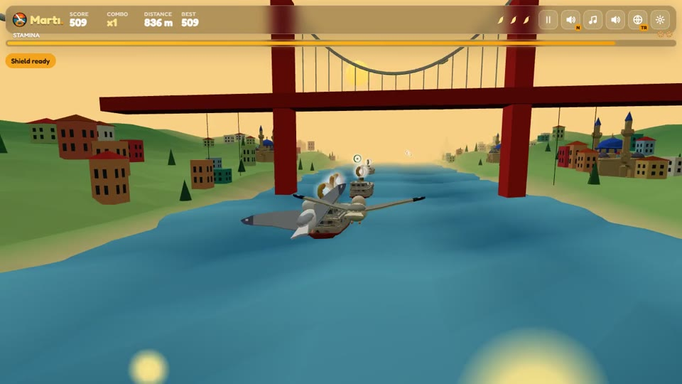
  </a>
</p>

<p align="center">
  <a href="https://furkiozknn.github.io/marti/"></a>
</p>

<p align="center">
  
  
  <a href="LICENSE"></a>
  
</p>

<!-- portals:start -->
<p align="center">
  Also on: <a href="https://furkiozknn.itch.io/marti"><strong>itch.io</strong></a> &middot; <a href="https://playgama.ai/play/5cyz2362utmnwl"><strong>Playgama</strong></a>
</p>
<!-- portals:end -->

<p align="center">
  <strong>An endless 3D arcade flyer over the Istanbul strait: as a seagull, snatch simit from ferry decks, dive for jumping fish, dodge bridges, masts and kites, and fly on from a golden afternoon through sunset into a night of fireworks.</strong>
</p>

<!-- gameplay gif -->

## Features

- **Endless flight over the strait:** Steer inside the corridor over the water across an endless run that speeds up after the first 30 seconds, journeying from afternoon gold through sunset to a starry night with lit windows and fireworks.
- **Stamina, feathers & nesting chick:** Manage draining stamina and 3 feathers; carry up to 2 simit to rooftop nests to chirp, earn +150, and recover a feather. Feeds accumulate across all runs (growing at 5, 15, and 30 feeds) until a young companion gull flies beside you and absorbs 1 hit per run.
- **Dynamic combos & near-miss scoring:** Build multipliers up to x5 (golden simit x2, tailwind x1.5 speed and score, shield feather absorbing 1 hit), snatch fish crates at jetty posts, and score +25 for close calls past hulls, masts, kites, and bridge cables.
- **Late-run ramp & daily missions:** Complete 3 missions a day saved to a local top-5 leaderboard; survive past 3 minutes as storm clouds thicken, kites fly in pairs, gusts give 2-second warnings, and hostile flocks fly 20% faster to steal simit.
- **Ultra-lean web performance:** A single `index.html` running Three.js r170 delivering 60 fps at 31 draw calls and 47k triangles on Intel UHD 620 (touch targets sized 44 px for phones), verified by an automated bot flying 796 seconds with 0 JS errors.

## How to play

> [!TIP]
> **Goal:** Fly as far and score as high as you can. The run is over when your stamina runs out or you lose all three feathers.

1. **Steer inside the corridor:** Guide the gull with the mouse, a finger, or arrow keys / `WASD` to keep it within the corridor over the water and clear of obstacles.
2. **Snatch simit & dive for fish:** Fly through simit rings on ferry decks and in the air to refill stamina and build combos; dive (hold `Space`, hold the mouse button, or tap) to catch jumping fish.
3. **Feed the chick:** Carry up to two simit to a rooftop nest on the shore and fly low past it to gain +150, recover a lost feather, and grow your companion bird over time.

<details>
<summary><b>Rules and hazards</b></summary>

- **Stamina drain:** Stamina starts full and drains a little faster every second, and faster still while diving. Simit and jumping fish refill it.
- **Combos & multipliers:** Every pickup in a row raises the combo; every fourth one adds 1 to the score multiplier, up to x5. A pause in pickups resets it.
- **Power-ups:** Tailwind boosts speed and score (x1.5), golden simit doubles score (x2), and shield feathers absorb one hit.
- **Obstacles:** Hitting a bridge deck, a cable, a hull, a mast, or a kite costs a feather, unless a shield feather absorbs the hit. Low hits on jetty posts beside piers also cost a feather.
- **Rival flock:** Hostile flocks steal your simit, cost stamina, and reset the combo multiplier.
- **Near-miss bonuses:** Passing a hull, a mast, a kite, or a cable closely scores +25.
- **Late-run ramp:** After three minutes storm clouds come more often, kites fly in pairs, hostile flocks are 20% faster, and a gust is announced two seconds before it pushes the gull.
- **Daily missions & scoring:** Three missions are generated every day (such as a 10 combo in one run or a target distance), and your top 5 runs are kept in browser storage.

</details>

### Controls

| Action | Mouse / touch | Keyboard |
|---|---|---|
| Steer | Move mouse / drag (relative to touch) | Arrows / `WASD` |
| Dive (for fish) | Hold mouse button / tap | Hold `Space` |
| Start / play again | Start button | `Space` / `Enter` |
| Pause menu (Resume, Restart, Settings, Main menu) | Pause button | `P` / `Esc` |
| Mute all sound (restores level) | Speaker button in top bar | `N` |
| Music / effects / language | Top bar | `M` / `X` / `L` |
| Fullscreen | Settings menu | `F` |

- **Touch:** Drag anywhere on screen relative to where your finger touched down; tap or hold to dive. Touch targets are at least 44 px for mobile play.
- **Audio control:** The speaker button in the top bar or hotkey `N` mutes music and effects together and remembers volume levels; Web Audio synthesizes dynamic beats, wing flaps, gull calls, and ferry horns. Pausing or hiding the tab silences everything.
- **Persistence:** Settings (master, music and effects volume, TR / EN, Low / High quality, fullscreen) are saved in `localStorage` under `arena.marti.settings`; top 5 scores under `arena.marti.best`; daily missions, chick level, hints, and fact indices under `arena.marti.save`. The first visit follows browser language.

<details>
<summary><b>URL flags for testing</b></summary>

| Flag | Effect |
|---|---|
| `?auto` | The game plays itself (self-test bot) |
| `?debug` | FPS, draw calls, state, loaded assets and JS errors on screen; `window.martiSim(seconds)` fast-forwards the game |
| `?sim=N` | Fast-forward N seconds once assets are ready |
| `?low` | No shadows, pixel ratio 1, half the particles |
| `?noassets` | Skip generated models (procedural fallback look) |
| `?lang=en` / `?lang=tr` | Start language |
| `?run` | Start a run straight away |
| `?t0=N` | Start each run N seconds into the day (`?t0=150` is night) |
| `?chick=N` | Show chick stage N (1 to 4) regardless of saved feeds; `?chick=4` brings the young gull |

`window.martiSim(seconds)` fast-forwards the simulation without rendering; `window.martiDebug` exposes live Three.js objects and collision boxes under `?debug`.

</details>

## Screenshots

<table>
  <tr>
    <td width="33%">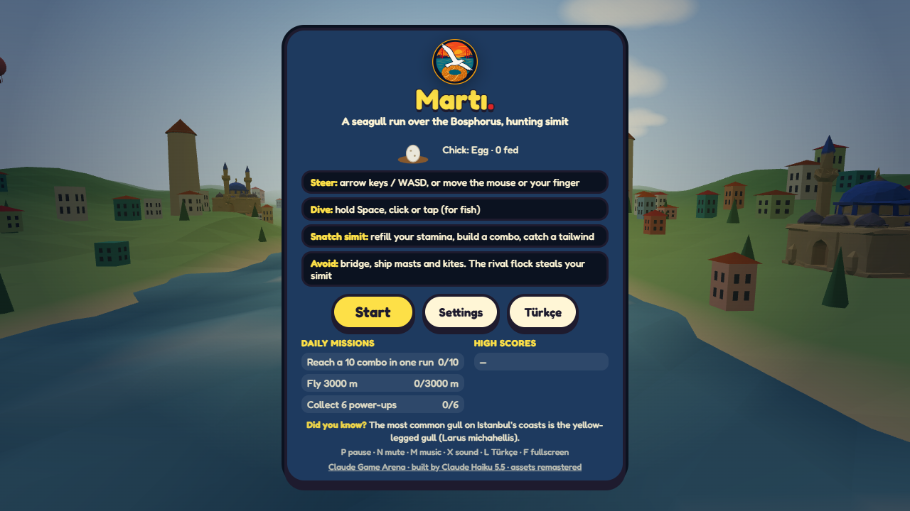<br><sub>Title screen and daily missions</sub></td>
    <td width="33%">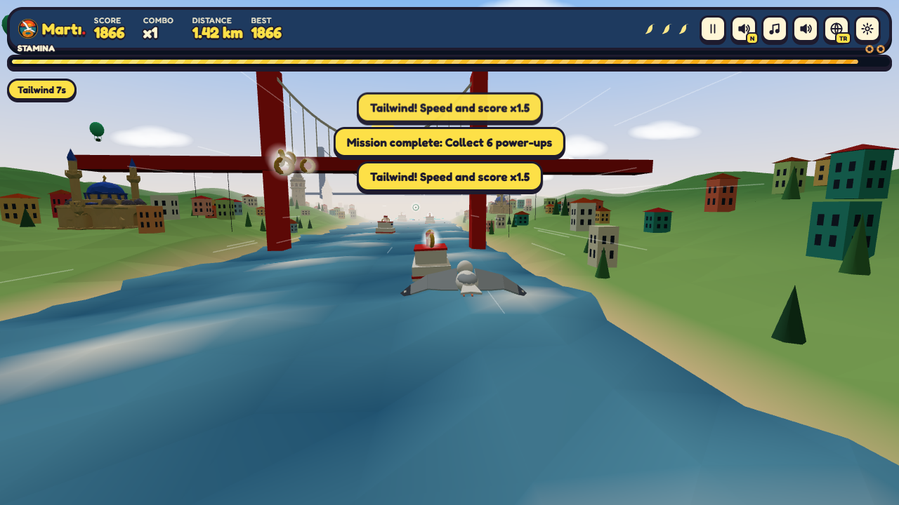<br><sub>Afternoon over the strait</sub></td>
    <td width="33%">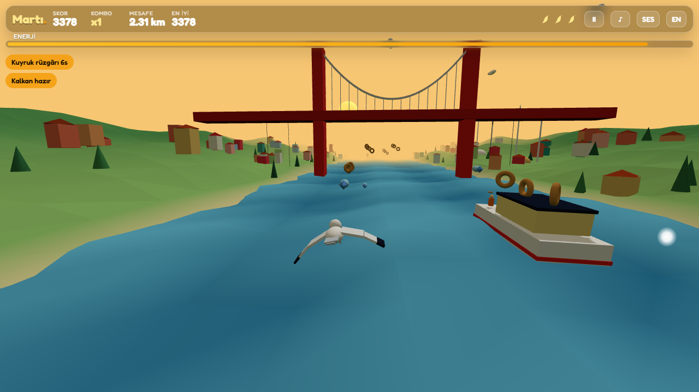<br><sub>Under the bridge</sub></td>
  </tr>
  <tr>
    <td>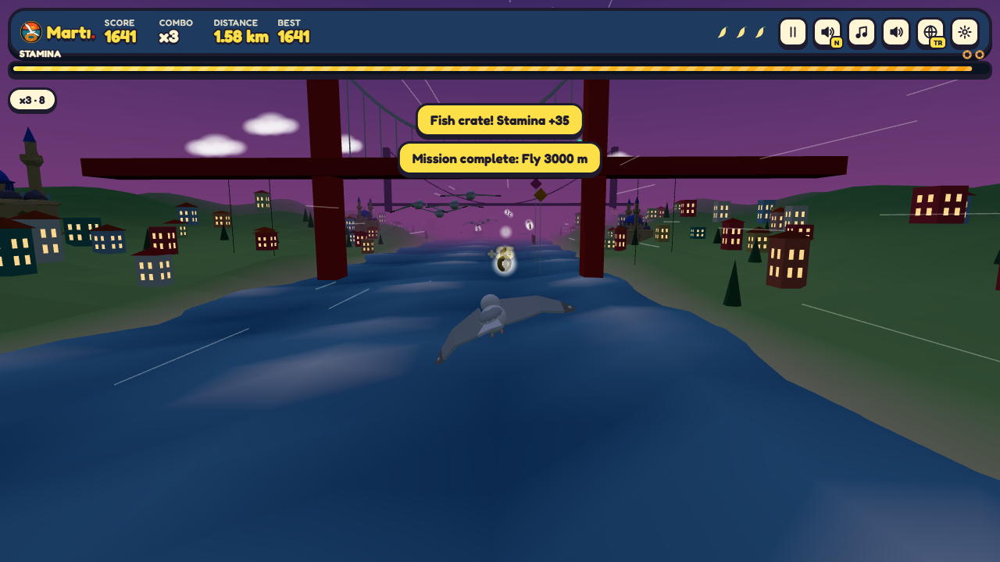<br><sub>Sunset and the Galata tower</sub></td>
    <td>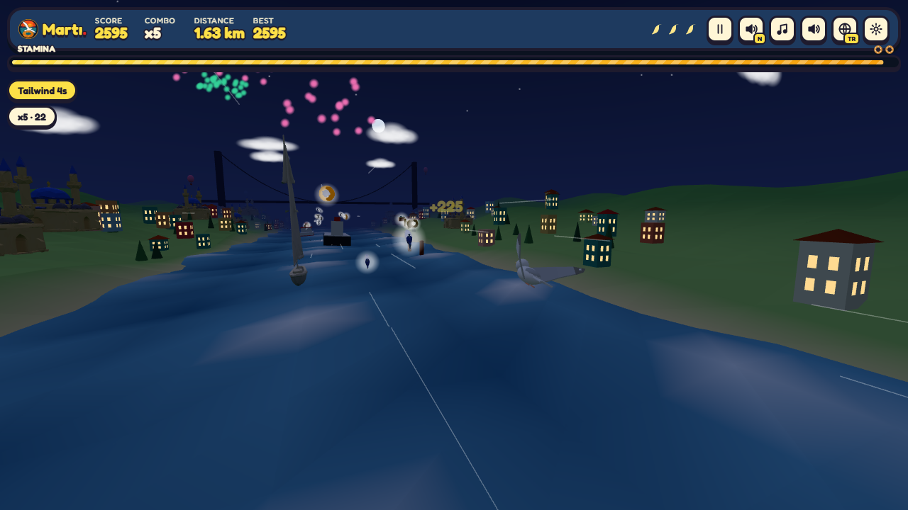<br><sub>Night, golden simit active</sub></td>
    <td>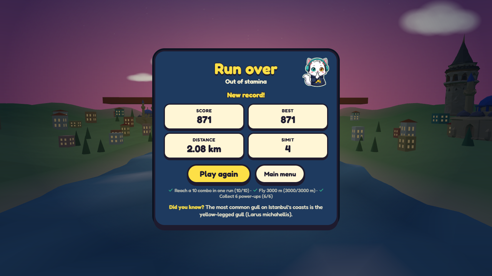<br><sub>Run over, new record</sub></td>
  </tr>
</table>

<details>
<summary><b>The gull up close, settings and the phone layout</b></summary>

<table>
  <tr>
    <td width="50%">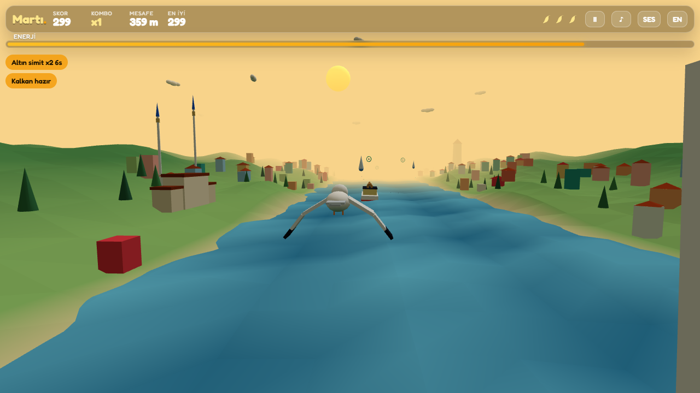<br><sub>The gull up close</sub></td>
    <td width="50%">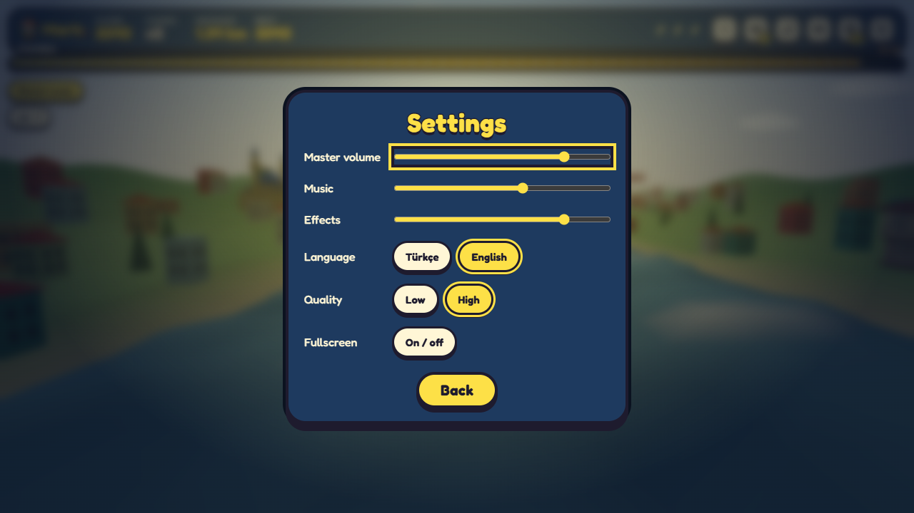<br><sub>Settings</sub></td>
  </tr>
</table>

<p align="center">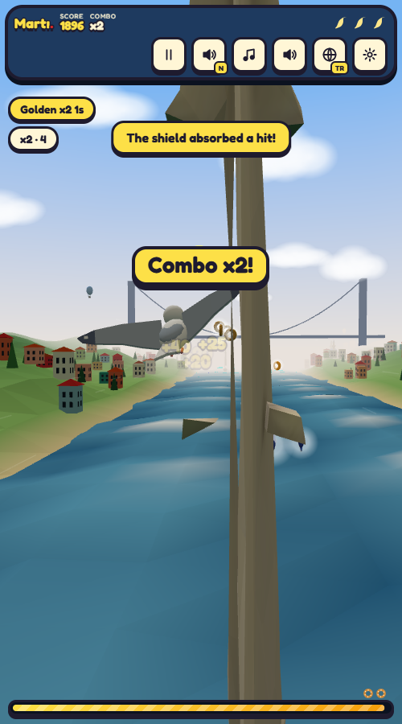<br><sub>On a phone</sub></p>

</details>

## Redesign & Performance

**Art direction:** A stylised 3D arcade flight, day to dusk over the strait. Sky from `#7DB8F5` at the zenith to a `#FFD6A5` horizon at sunset, sea `#1E6091` with foam crests, white and red ferries, sun-yellow and navy arcade panels.

**Visual updates (gameplay, controls, flags, keys, saved data and counts are untouched):**
- **Sky and light:** A gradient dome from day through sunset to night (the horizon colour is also the fog), soft canvas cloud sprites, and a dark Bosphorus bridge silhouette on the horizon.
- **Sea:** Wave crests turn to foam; the foam is sparse so it reads as crests, not a white sheet.
- **Ferries:** Red and white livery (white hull and cabin, red waterline band and roof, a blue window band, a red funnel).
- **Motion:** Speed lines fade in above speed 32 and rush past the camera; a "Combo xN!" badge pops in whenever the multiplier goes up.
- **UI:** Navy and cream arcade panels with a dark outline and a solid shadow, chunky outlined numbers, sun-yellow focus rings, striped stamina bar (red when low), and 44 px touch targets on phones.

**Measured on an Intel UHD 620 (headless Chrome, 1280x720):**
- Draw calls: 29 &rarr; 31
- Triangles: 51k &rarr; 47k (procedural ferry is lighter than generated model)
- Page rAF: ~60 fps in gameplay (headless frame rate)
- `?auto` bot: 120 simulated seconds with 0 JS errors (with assets and with `?noassets`)
- Bot flight in real browser: 796 seconds before stamina exhaustion with 0 JS errors

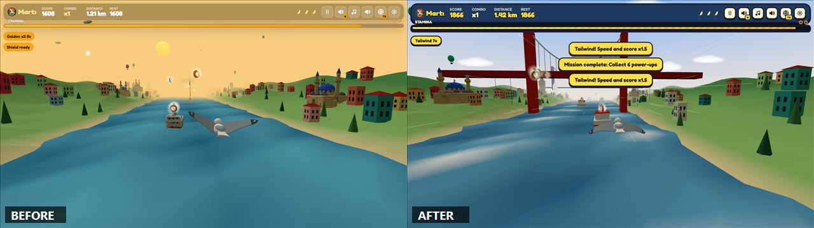

## Running locally

Serve the folder over HTTP (opened from `file://`, the browser blocks model files and the game falls back to procedural models):

```bash
python -m http.server 8000
```

Then open <http://localhost:8000/>.

## Made with Claude Code

Built by **Claude Haiku 5.5** with Claude Code from one prompt: [prompts/marti.md](prompts/marti.md). The first version was fully procedural: the strait, the shores, the boats, the landmarks, and the gull are low-poly primitives with vertex colours, and the music and sounds are synthesised with the Web Audio API. Before release, an independent bot run in a real browser flew 796 seconds before running out of stamina, with 0 JS errors.

The assets were remastered by the orchestrator, **Claude Opus 5.5**, with generated models: Tripo text-to-3D (through Higgsfield) for the simit (also the golden simit), the fish, the shield feather, the ferry, the fishing boat, the sailboat, the mosque, the Galata tower, the Maiden's tower, and the yalı, and GPT Image for the crest and the favicon. They were fitted with glTF-Transform (about 0.88 MB in `assets/`), and every procedural model stays as the fallback. A generated gull was tried and rejected, so the gull is a redesigned procedural one with grey wing tops, white undersides, and black tips (see [docs/assets.md](docs/assets.md)). A Godot 4 remake was made in round 2.

### v2 update

Upgraded by **Claude Haiku 5.5** with Claude Code from [prompts/marti-v2.md](prompts/marti-v2.md). The v2 pass adds the first-run prompts (steer, dive, stamina; each shown once and remembered), the mute key (`N`), the rooftop nests and the chick that grows across runs, pier snacks with jetty posts, near-miss bonuses (+25), the late-run ramp with gust warnings, a soft halo behind simit, fish, and power-ups, and the "Did you know" facts (sourced in comments in `index.html`). The saved data keeps its keys (`arena.marti.settings`, `arena.marti.best`, `arena.marti.save`); the save record gains the fields `chick`, `hints`, and `factIdx`. Mascot: a small Turkish Van kitten on the game-over card, see [CREDITS.md](CREDITS.md).

<details>
<summary><b>Technical notes</b></summary>

- **Flight corridor & spawning:** Flight is bounded to a 40-unit corridor (`CORR = 20`) over the water (`YMIN = 2.4`, `YMAX = 33`), spawning terrain, boats, obstacles, and pickups up to 340 units ahead (`LOOK = 340`) and pruning objects 90 units behind (`BACK = 90`).
- **Procedural and generated hybrid:** Procedural geometry builders serve as instant fallbacks if WebGL asset fetching fails or if `?noassets` is passed. Instanced meshes (`InstancedMesh`) are used for mosques, houses, trees, and scenery to keep draw calls low (31 draw calls).
- **Audio synthesis (Web Audio API only):** A dynamic layered beat that speeds up with run velocity, synthesised gull calls, wing flaps, and ferry horns; pausing or hiding the tab silences everything.
- **Rendering & performance:** Single-file Three.js r170 running with directional light, fog matching horizon colours across day-to-night transitions, canvas cloud sprites, and particle effects for foam and tailwinds, optimized for Intel UHD 620 integrated graphics.

</details>

### Claude Game Arena

Martı is part of the **Claude Game Arena** series, where each game is built by a Claude model from one prompt.

[Hisar](https://furkiozknn.github.io/kale-savunmasi/) · [Çay Ocağı](https://furkiozknn.github.io/cay-ocagi/) · [Çini Ustası](https://furkiozknn.github.io/cini-ustasi/) · [Kervan](https://furkiozknn.github.io/kervan/) · [Dolmuş](https://furkiozknn.github.io/dolmus/) · [Peri Golf](https://furkiozknn.github.io/peri-golf/) · [Mehter](https://furkiozknn.github.io/mehter/) · [Boğaz Vapuru](https://furkiozknn.github.io/bogaz-vapuru/) · [Simit Fırını](https://furkiozknn.github.io/simit-firini/) · [Karagöz](https://furkiozknn.github.io/karagoz/) · [Lale Bahçesi](https://furkiozknn.github.io/lale-bahcesi/)

**Round 5:** [Kapadokya Balonu](https://furkiozknn.github.io/kapadokya-balonu/) · [Ebru](https://furkiozknn.github.io/ebru/) · [Kırkpınar](https://furkiozknn.github.io/kirkpinar/) · [Çarşı Kaçışı](https://furkiozknn.github.io/carsi-kacisi/)

**Round 6:** [Topkapı Gecesi](https://furkiozknn.github.io/topkapi-gecesi/) · [Hamsi](https://furkiozknn.github.io/hamsi/) · [Pamukkale](https://furkiozknn.github.io/pamukkale/) · [Mimar Sinan](https://furkiozknn.github.io/mimar-sinan/)

## License

MIT, see [LICENSE](LICENSE).

Like the game? You can support new rounds on [Buy Me a Coffee](https://buymeacoffee.com/furkiozkann). The game stays free.
